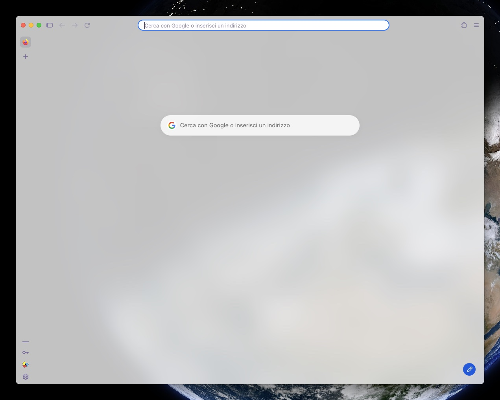
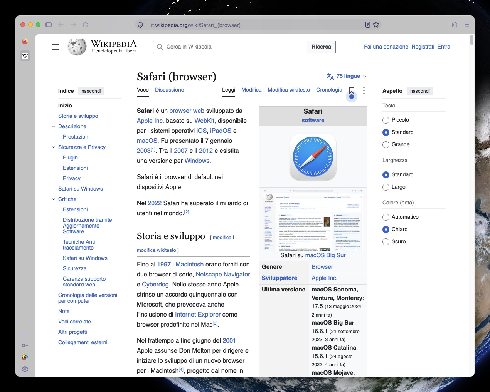

# safarizemyfox

Progetto vibecoded.
Firefox per macOS con l'aspetto di Safari: barre e sidebar trasparenti con la sfocatura nativa di macOS, colore di accento di sistema, barra indirizzi centrata, pagina nuova scheda minimale e tema scuro "vetro".

## Screenshot

Pagina iniziale: la finestra lascia vedere la scrivania sfocata, come la pagina di apertura di Safari.



Un sito qualsiasi: barra e sidebar restano di vetro, la pagina è opaca.



## Requisiti

- macOS
- Firefox 158 o successivo
- Tema **Sistema – automatico** (`about:addons` → Temi). Con qualsiasi altro tema la trasparenza si disattiva.
- Nessuna estensione che cambia il tema, ad esempio *Adaptive Tab Bar Colour*.
- *Riduci trasparenza* disattivato (Impostazioni di Sistema → Accessibilità → Schermo).

## Installazione

1. In Firefox apri `about:support` e, alla voce **Cartella del profilo**, clicca **Mostra in Finder**.
2. Chiudi Firefox (Cmd+Q).
3. Copia i file nel profilo:

   ```bash
   PROFILE="$HOME/Library/Application Support/Firefox/Profiles/<nome-profilo>"
   cp -R chrome "$PROFILE/"
   cat user.js >> "$PROFILE/user.js"
   ```

   `cat >>` aggiunge le impostazioni a un eventuale `user.js` già presente invece di sovrascriverlo. Se nel profilo esiste già una cartella `chrome`, unisci a mano i tuoi `userChrome.css` e `userContent.css`.

4. Riapri Firefox.

Per provarlo senza toccare il profilo principale, crea un profilo nuovo da `about:profiles` e installa lì.

## Personalizzazione

In `user.js`:

```js
user_pref("browser.theme.toolbar-theme", 0); // 0 scuro, 1 chiaro, 2 segue macOS
```

## Disinstallazione

1. Chiudi Firefox ed elimina `chrome/` dal profilo, poi rimuovi da `user.js` le righe aggiunte.
2. Firefox conserva in `prefs.js` i valori già applicati: per ripristinarli cerca ciascuna impostazione in `about:config` e clicca **Ripristina**.

## Limiti

- Le pagine web restano opache, come in Safari.
- La barra di caricamento non mostra l'avanzamento reale: Firefox non lo espone al CSS.
- Quando la finestra non è in primo piano la trasparenza si spegne. Safari la mantiene, ma Firefox imposta il vetro su `NSVisualEffectStateFollowsWindowActiveState` nel codice (`widget/cocoa/VibrancyManager.mm`) e nessuna impostazione lo cambia.
- `userChrome.css` usa selettori interni di Firefox, che un aggiornamento può cambiare.
